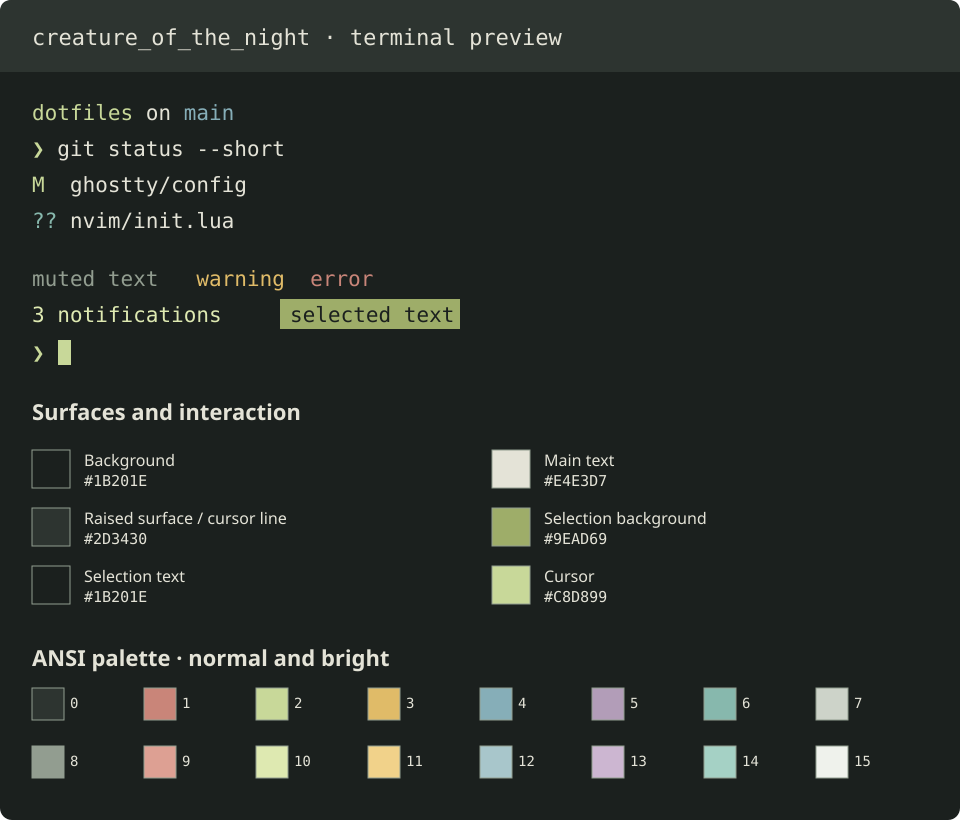
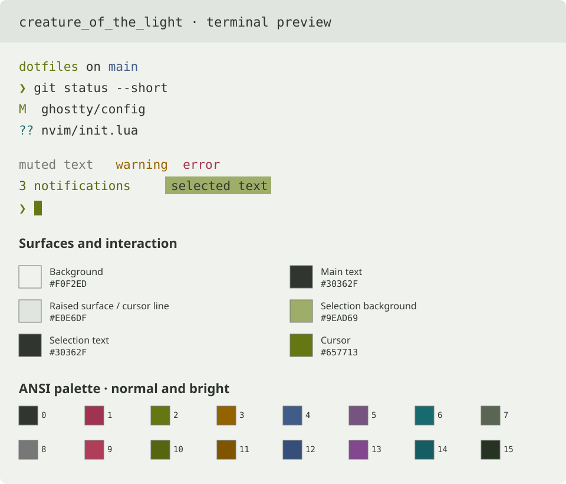

# Frankenstein

🧟 A greenish theme for a comfortable everyday development experience, inspired by you know who.

Like the state of IT, it's neither dead nor alive.

## Variants

| Night | Light |
| --- | --- |
|  |  |

The previews illustrate the palette; applications may use the colors differently. Click an image to see it at full size.

## Install

Each application folder contains its theme and installation instructions:

- [Ghostty](ghostty/README.md)
- [Neovim](neovim/README.md)

## Palette

Both variants share green accents and muted surfaces, with colors chosen for their respective backgrounds.

<!-- BEGIN GENERATED PALETTES -->

### Surfaces and interaction

| Token or role | creature_of_the_night | creature_of_the_light |
| --- | --- | --- |
| Background | $\color{#1B201E}{\blacksquare}$ `#1B201E` | $\color{#F0F2ED}{\blacksquare}$ `#F0F2ED` |
| Main text | $\color{#E4E3D7}{\blacksquare}$ `#E4E3D7` | $\color{#30362F}{\blacksquare}$ `#30362F` |
| Raised surface / cursor line | $\color{#2D3430}{\blacksquare}$ `#2D3430` | $\color{#E0E6DF}{\blacksquare}$ `#E0E6DF` |
| Selection background | $\color{#9EAD69}{\blacksquare}$ `#9EAD69` | $\color{#9EAD69}{\blacksquare}$ `#9EAD69` |
| Selection text | $\color{#1B201E}{\blacksquare}$ `#1B201E` | $\color{#30362F}{\blacksquare}$ `#30362F` |
| Cursor | $\color{#C8D899}{\blacksquare}$ `#C8D899` | $\color{#657713}{\blacksquare}$ `#657713` |
| Text under cursor | $\color{#1B201E}{\blacksquare}$ `#1B201E` | $\color{#F0F2ED}{\blacksquare}$ `#F0F2ED` |
| Muted text / comments / punctuation | $\color{#929D90}{\blacksquare}$ `#929D90` | $\color{#777777}{\blacksquare}$ `#777777` |

Use raised surfaces to distinguish secondary areas from the main background.

### ANSI palette

ANSI slot names describe terminal color roles. In light mode, the white slots are
dark neutrals suitable for text. Bright slots are alternate accents; they can be
deeper rather than lighter on a pale background.

| ANSI slot | Token | creature_of_the_night | creature_of_the_light |
| --- | --- | --- | --- |
| 0 | Black | $\color{#2D3430}{\blacksquare}$ `#2D3430` | $\color{#30362F}{\blacksquare}$ `#30362F` |
| 1 | Red | $\color{#C98579}{\blacksquare}$ `#C98579` | $\color{#A03350}{\blacksquare}$ `#A03350` |
| 2 | Green | $\color{#C8D899}{\blacksquare}$ `#C8D899` | $\color{#657713}{\blacksquare}$ `#657713` |
| 3 | Yellow | $\color{#E0BB68}{\blacksquare}$ `#E0BB68` | $\color{#946300}{\blacksquare}$ `#946300` |
| 4 | Blue | $\color{#86AEB8}{\blacksquare}$ `#86AEB8` | $\color{#405D89}{\blacksquare}$ `#405D89` |
| 5 | Magenta | $\color{#B29DB8}{\blacksquare}$ `#B29DB8` | $\color{#76547F}{\blacksquare}$ `#76547F` |
| 6 | Cyan | $\color{#87B8AD}{\blacksquare}$ `#87B8AD` | $\color{#176B70}{\blacksquare}$ `#176B70` |
| 7 | White | $\color{#CDD3C9}{\blacksquare}$ `#CDD3C9` | $\color{#596653}{\blacksquare}$ `#596653` |
| 8 | Bright black | $\color{#929D90}{\blacksquare}$ `#929D90` | $\color{#777777}{\blacksquare}$ `#777777` |
| 9 | Bright red | $\color{#DDA093}{\blacksquare}$ `#DDA093` | $\color{#B03D5A}{\blacksquare}$ `#B03D5A` |
| 10 | Bright green | $\color{#DEE9B1}{\blacksquare}$ `#DEE9B1` | $\color{#566610}{\blacksquare}$ `#566610` |
| 11 | Bright yellow | $\color{#F1D28A}{\blacksquare}$ `#F1D28A` | $\color{#805500}{\blacksquare}$ `#805500` |
| 12 | Bright blue | $\color{#A8C6CB}{\blacksquare}$ `#A8C6CB` | $\color{#354F7A}{\blacksquare}$ `#354F7A` |
| 13 | Bright magenta | $\color{#CCB6D1}{\blacksquare}$ `#CCB6D1` | $\color{#82478E}{\blacksquare}$ `#82478E` |
| 14 | Bright cyan | $\color{#A5D1C5}{\blacksquare}$ `#A5D1C5` | $\color{#155D62}{\blacksquare}$ `#155D62` |
| 15 | Bright white | $\color{#EFF2EC}{\blacksquare}$ `#EFF2EC` | $\color{#263323}{\blacksquare}$ `#263323` |

### Additional semantic colors

| Role | creature_of_the_night | creature_of_the_light |
| --- | --- | --- |
| Symbolic operators (`operator`) | $\color{#B2B69C}{\blacksquare}$ `#B2B69C` | $\color{#5A6B5B}{\blacksquare}$ `#5A6B5B` |

<!-- END GENERATED PALETTES -->

## Contributing

Issues and pull requests are welcome. Include the application, variant, and steps to reproduce; screenshots help with visual issues. A pull request with a fix is even better.

AI-assisted contributions are okay. You are responsible for reviewing the code you submit. Contributors who submit abusive or spam pull requests will be blocked.

By contributing, you agree to license your work under the project's MIT license. Please submit only material you have the right to share. See [CONTRIBUTING.md](CONTRIBUTING.md) for palette and implementation guidance.

## License

[MIT](LICENSE) © 2026 Oleksii Pastuhov and contributors.
